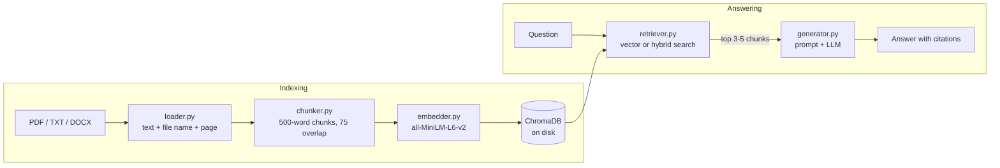

# Chat with your documents

A Retrieval-Augmented Generation (RAG) web app. Upload PDF, TXT or DOCX files,
ask questions in a chat, and get answers that come **only** from those
documents, with citations to the file and page. When the documents do not
contain the answer, the app says so instead of guessing.

The retrieval pipeline is written from scratch (no LangChain or LlamaIndex)
and is evaluated on SQuAD.

## Features

- Upload and index multiple PDF, TXT and DOCX files
- Chat interface with streamed answers
- Citations in the form `[file name, page N]`
- Expandable **Sources** section showing the retrieved chunks and their scores
- Refuses with "I couldn't find this in the documents." when the answer is not there
- Two search modes: vector search, or hybrid search (vector + BM25 keyword search)
- Index stored on disk, with a button to clear it
- Runs fully locally with Ollama; a hosted LLM can be switched on for deployment

## Screenshots

<!-- Replace with real screenshots, e.g. docs/screenshot_chat.png -->

| Chat with citations | Sources section |
|---|---|
| _screenshot placeholder_ | _screenshot placeholder_ |

## Architecture



| Stage | File | What it does |
|---|---|---|
| Load | `rag/loader.py` | Extracts text per page with pypdf / python-docx and keeps the file name and page number |
| Chunk | `rag/chunker.py` | Splits each page into overlapping word windows; chunks never cross a page, so citations are exact |
| Embed | `rag/embedder.py` | Encodes text into normalised 384-dimensional vectors with `all-MiniLM-L6-v2` |
| Retrieve | `rag/retriever.py` | Stores vectors in ChromaDB; searches by cosine similarity, or fuses vector and BM25 rankings with Reciprocal Rank Fusion |
| Generate | `rag/generator.py` | Builds a grounded prompt and streams the answer from Ollama (or Groq) |
| UI | `app.py` | Streamlit chat interface |
| Evaluate | `evaluate.py` | Measures retrieval and answer quality on SQuAD |

## Tech stack

Python 3.10+ · sentence-transformers · ChromaDB · rank-bm25 · Ollama · Streamlit · Hugging Face `datasets`

## Installation

Requirements: Python 3.10 or newer, and [Ollama](https://ollama.com) for the local LLM.

```bash
git clone <your-repo-url>
cd <your-repo-folder>

python -m venv .venv
.venv\Scripts\activate          # Windows
# source .venv/bin/activate     # macOS / Linux

pip install -r requirements.txt

ollama pull llama3.2

copy .env.example .env          # Windows
# cp .env.example .env          # macOS / Linux
```

## Usage

```bash
streamlit run app.py
```

Then open http://localhost:8501, upload documents in the sidebar, click
**Index documents**, and ask questions.

To try it right away with sample papers:

```bash
python demo_docs/download_papers.py
```

See [demo_docs/README.md](demo_docs/README.md) for the paper list and example questions.

### Configuration

Settings are read from `.env` (see `.env.example`). No keys are hard-coded.

| Variable | Default | Meaning |
|---|---|---|
| `LLM_PROVIDER` | `ollama` | `ollama` (local) or `groq` (hosted) |
| `OLLAMA_HOST` | `http://localhost:11434` | Address of the Ollama server |
| `OLLAMA_MODEL` | `llama3.2` | Local model used for answers |
| `GROQ_API_KEY` | empty | Only needed when `LLM_PROVIDER=groq` |
| `GROQ_MODEL` | `llama-3.1-8b-instant` | Hosted model used for answers |
| `CHROMA_DIR` | `chroma_db` | Folder where the index is stored |
| `PER_SESSION_INDEX` | `false` | `true` gives each visitor a private, temporary index (for public deployments) |
| `TOP_K` | `4` | Default number of chunks to retrieve |
| `CHUNK_SIZE` / `CHUNK_OVERLAP` | `500` / `75` | Chunking, in words |

## Evaluation

```bash
python evaluate.py                    # 200 questions, all settings
python evaluate.py --n 50             # quicker run
python evaluate.py --skip-generation  # retrieval metrics only
```

**Setup.** 200 random questions from the SQuAD v1.1 validation set (seed 42).
All 2,067 unique paragraphs of the validation set are indexed, so every
question competes against about 2,000 distractor paragraphs. The script uses
the same chunker, retriever and generator as the app.

**Metrics.**

- **Hit@k**: share of questions whose source paragraph appears in the top k retrieved chunks.
- **Exact Match / F1**: the generated answer compared with the SQuAD reference answers, using the official SQuAD normalisation.

### Retrieval results

| Chunk size / overlap | Search mode | Hit@1 | Hit@3 | Hit@5 |
|---|---|---|---|---|
| 500 / 75 | vector | 57.5 | 77.0 | 83.0 |
| 500 / 75 | **hybrid** | **64.5** | **84.0** | **91.0** |
| 100 / 20 | vector | 58.5 | 74.5 | 81.0 |
| 100 / 20 | hybrid | 66.0 | 81.5 | 89.0 |

Values in %. Full output: [results/eval_results.csv](results/eval_results.csv).

**Findings.**

- **Hybrid search beats vector search by 6 to 8 points on every metric.**
  SQuAD questions often reuse exact words from the paragraph (names, dates,
  numbers), which BM25 matches directly and a small embedding model can miss.
- **Chunk size has little effect on this dataset.** Differences are 1 to 2.5
  points (2 to 5 questions out of 200), which is within noise. SQuAD
  paragraphs average about 120 words, so most fit in a single chunk at either
  setting.
- Smaller chunks score slightly lower at Hit@3 and Hit@5, likely because
  several chunks of one paragraph can occupy the top results.

### Answer quality

<!-- Fill in after running `python evaluate.py` with Ollama running. -->

| Chunk size / overlap | Search mode | Exact Match | F1 | Not found % |
|---|---|---|---|---|
| 500 / 75 | vector | _to run_ | _to run_ | _to run_ |
| 500 / 75 | hybrid | _to run_ | _to run_ | _to run_ |
| 100 / 20 | vector | _to run_ | _to run_ | _to run_ |
| 100 / 20 | hybrid | _to run_ | _to run_ | _to run_ |

Model: `llama3.2` via Ollama, temperature 0, top 4 chunks in the prompt.

## Project structure

```
.
├── app.py                  # Streamlit UI
├── evaluate.py             # SQuAD evaluation
├── rag/
│   ├── loader.py           # PDF / TXT / DOCX -> text with source metadata
│   ├── chunker.py          # overlapping word-window chunking
│   ├── embedder.py         # sentence-transformers embeddings
│   ├── retriever.py        # ChromaDB store, vector + hybrid search
│   └── generator.py        # prompt building and LLM calls
├── demo_docs/              # script to download sample arXiv papers
├── results/                # evaluation output (CSV)
├── requirements.txt
└── .env.example
```

## Limitations

- Scanned PDFs are not supported (no OCR).
- Text inside DOCX tables is not extracted.
- `all-MiniLM-L6-v2` reads at most 256 tokens (about 190 words), so with
  500-word chunks only the first part of each chunk influences vector search.
- Each question is answered independently; earlier chat turns are not used.
- Grounding and refusal rely on the LLM following the prompt. Small local
  models do this less reliably than large ones.

## Future improvements

- Conversation memory: rewrite follow-up questions using the chat history
- A cross-encoder re-ranker on the top 20 candidates
- A similarity threshold to refuse before calling the LLM
- Sentence-aware or structure-aware chunking instead of fixed word windows
- OCR for scanned PDFs and table extraction
- A larger embedding model with a longer input window
- Evaluation of faithfulness (is every claim supported by a cited chunk?) and
  of refusals on unanswerable questions (SQuAD v2)

## Deployment

The app can be hosted for free on Streamlit Community Cloud:

1. Push this repository to GitHub.
2. At [share.streamlit.io](https://share.streamlit.io), create an app from the
   repository with `app.py` as the main file.
3. Free hosts cannot run Ollama, so add these under **Advanced settings → Secrets**
   (never in the repository):

   ```toml
   LLM_PROVIDER = "groq"
   GROQ_API_KEY = "your-key"
   PER_SESSION_INDEX = "true"
   ```

With `PER_SESSION_INDEX` on, every visitor gets a private in-memory index that
is removed when their session ends, so visitors never see each other's
documents. Questions and the retrieved passages are still sent to the hosted
LLM provider.
